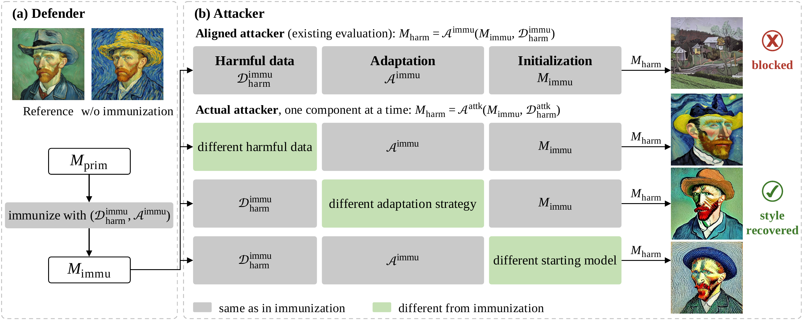

# Model Immunization Cannot Reliably Protect Models from Harmful Adaptation

Code for the paper **"Model Immunization Cannot Reliably Protect Models from Harmful
Adaptation"**. We evaluate four immunization methods — **IMMA**, **Condition Number
(CondNum)**, **CLAMP**, and **MIMA** — under *attacker misalignment* in harmful data,
adaptation strategy, and model initialization.



## Environment

- PyTorch 2.1 (CUDA 12.1)
- Diffusion side: `diffusers==0.19.0`, `transformers==4.30.2`, `accelerate==0.20.3`
- Classification side: `timm`, `pytorch-lightning`
- Set `IMMA_ROOT` / `CLAMP_ROOT` to the directories holding data and checkpoints.

## Usage

Each experiment follows the pipeline in the figure: **immunize → misalign → adapt →
evaluate**.

### 1. Immunize

**Diffusion**:\
IMMA, with analogous scripts for CLAMP generation and MIMA under
`baselines/clamp/tools/repro/` and `baselines/mima/repro/`.

```bash
accelerate launch baselines/imma/train/defend_text_to_image_lora.py \
    --pretrained_model_name_or_path CompVis/stable-diffusion-v1-4 \
    --train_data_dir <harmful_data> --output_dir <immunized_model>
```

**Classification**:\
CondNum, and CLAMP uses `baselines/clamp/immunize.py`.

```bash
python baselines/cn/main.py --config baselines/cn/configs/resnet18_<task>.yaml
```

### 2. Apply one misalignment

**Image misalignment**:\
Draw the harmful images from another generator.

```bash
python misalignments/image/gen_corpus.py --out-template '<out>/{key}'
```

**Prompt misalignment**:\
Re-caption the harmful images.

```bash
python misalignments/prompt/make_reanchor_data.py --out-root <out>
```

**Perturbation misalignment**:\
Perturb the attacker's images, for diffusion and for classification.

```bash
python baselines/imma/pgd_imma/pgd_attack.py --loss l1 --tag <out>
python baselines/clamp/tools/unrolled_head.py --mode attack --ckpt <model> \
    --clean_root <attacker_data> --out <out>
```

**Initialization misalignment**:\
Rescale the attention weights of the released model.

```bash
python misalignments/initialization/reparam.py <artist> <immunized_model> <c> <out>
```

**Adaptation-strategy misalignment**:\
No script needed, change `--learning_rate` or `--rank` in step 3.

### 3. Adapt

**Diffusion**:\
Rank-4 LoRA on the released model.

```bash
accelerate launch baselines/imma/train/train_text_to_image_lora.py \
    --pretrained_model_name_or_path CompVis/stable-diffusion-v1-4 \
    --imma_ckpt <immunized_model> --train_data_dir <attacker_data> --output_dir <out>
```

**Classification**:\
Linear probe on frozen features.

```bash
python baselines/clamp/adapt.py --config baselines/clamp/configs/<task>.yaml \
    --checkpoint <immunized_model> --output <out>
```

### 4. Evaluate

**Diffusion**:\
Similarity (CLIP, DINO, 1 − LPIPS), then SGR.

```bash
python baselines/imma/eval/eval.py --reference_dir <ref> --base_dir <no_immu> --imma_dir <immu>
python baselines/imma/compute_sgr.py --run_dir <run> --reference_dir <ref>
```

**Classification**:\
`adapt.py` in step 3 already reports the clean test accuracy.

## Acknowledgements and license

Builds on the official implementations of IMMA, CondNum, CLAMP, and MIMA,
all released under the Apache License 2.0.
This repository is also released under the Apache License 2.0, see [LICENSE](LICENSE).
